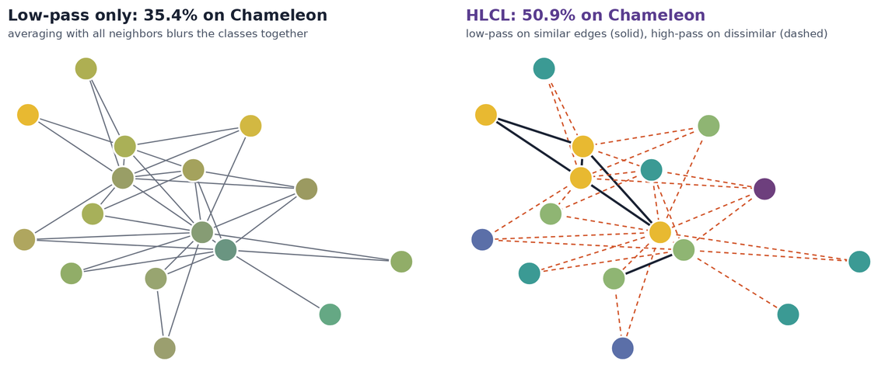

# HLCL: Graph Contrastive Learning under Heterophily via Graph Filters

**UAI 2024** · [Wenhan Yang](https://hangeryang.github.io/), [Baharan Mirzasoleiman](https://baharanm.github.io/) · UCLA

[Project page](https://hangeryang.github.io/HLCL/) · [Paper](https://arxiv.org/abs/2303.06344) · [PMLR](https://proceedings.mlr.press/v244/yang24a.html)

<p align="center"></p>

**HLCL is the first graph contrastive learning method built on graph filters.** On heterophilic graphs, connected nodes usually belong to different classes, so the neighbor averaging that GNNs and graph contrastive learning rely on erases what tells nodes apart. HLCL splits the graph by node-feature similarity into a homophilic and a heterophilic subgraph, applies a **low-pass** filter where neighbors agree and a **high-pass** filter where they differ, and contrasts both kinds of augmented views with one shared encoder. No labels are used.

| | Chameleon | Squirrel | Penn94 | Twitch-gamers |
|---|---|---|---|---|
| Best other self-supervised method | 43.9 | 38.8 | 62.9 | 62.0 |
| Best supervised method | 40.9 | 39.5 | 85.6 | 66.4 |
| **HLCL** | **50.9** | **42.9** | 68.1 | **67.0** |

HLCL improves on existing graph contrastive learning methods by up to 7 points and on supervised methods by up to 10 points under heterophily, stays competitive under homophily, and scales to graphs with millions of edges. Full results are on the [project page](https://hangeryang.github.io/HLCL/).

## Installation

```bash
pip install -r requirements.txt
```

## Usage

```bash
python HLCL.py \
  --device 0 \
  --dataset pubmed \
  --low_k 0.8 \
  --high_k 0.2 \
  --augmentation PPRDiffusion \
  --haug1 0.4 \
  --runs 3 \
  --num_parts 3
```

| Flag | Meaning |
|---|---|
| `--low_k` | k₁: fraction of each node's most similar edges kept in the homophilic subgraph |
| `--high_k` | k₂: fraction of each node's least similar edges kept in the heterophilic subgraph |
| `--per_epoch` | T: refresh the two subgraphs every T epochs (default 50) |
| `--augmentation`, `--haug1`, `--haug2` | Augmentation for the heterophilic subgraph and its strength |
| `--num_parts` | Split large graphs into parts for mini-batch training |

A good starting point is to set `--low_k` close to the graph's homophily ratio. Results and checkpoints are saved in `./result/` and `./model/`.

## Citation

```bibtex
@inproceedings{yang2024graph,
  title     = {Graph Contrastive Learning under Heterophily via Graph Filters},
  author    = {Yang, Wenhan and Mirzasoleiman, Baharan},
  booktitle = {Proceedings of the Fortieth Conference on Uncertainty in Artificial Intelligence},
  series    = {Proceedings of Machine Learning Research},
  volume    = {244},
  publisher = {PMLR},
  year      = {2024}
}
```
